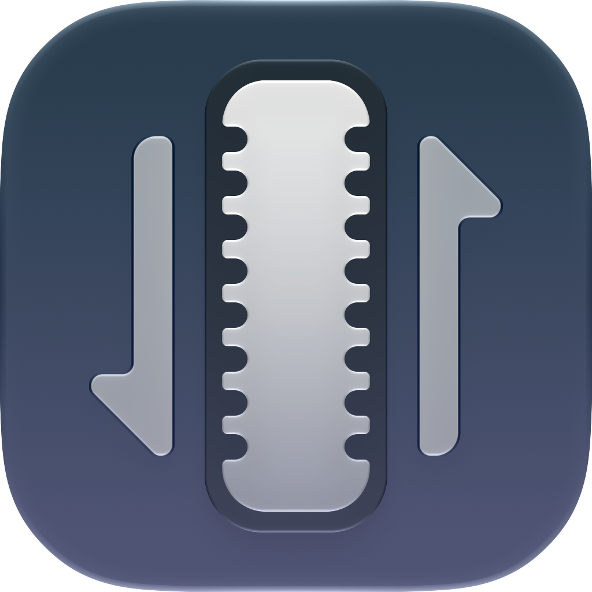

# Toggle Natural Scrolling

<p align="center">
  
</p>

[](Info.plist)


Ever switch between an external mouse at your desk and your MacBook's trackpad, then have to dig through System Settings to change scroll direction? I made this small app to make that switch a one-click action from the app icon.

## What it does

- Toggles the global scroll direction between Natural and Traditional.
- Applies the change immediately and shows a notification when successful.
- Reports errors and attempts to restore the previous preferences if saving or applying the change fails.
- Opens no window and exits after toggling; it does not leave a running Dock icon.

## Requirements

- macOS (tested on macOS Tahoe 26.x; other versions have not been verified)
- Xcode Command Line Tools to build (`xcode-select --install`)

## Build

From the repository root, run:

```bash
bash build.sh
```

This builds `build/ToggleNaturalScrolling.app` with the included icon and ad-hoc signs it for local use. The script will not overwrite an existing output; to build to a different location, pass an output path:

```bash
bash build.sh Resources/AppIcon.png /tmp/ToggleNaturalScrolling.app
```

Ad-hoc signing does not notarize the app for distribution.

## Install and use

Copy `build/ToggleNaturalScrolling.app` to `/Applications/` or another location. Launch the app to toggle the scroll direction. For quick access, you can keep a launcher for it in the Dock; the utility itself runs and exits without a persistent Dock icon.

The app writes the global scroll direction preference for both AnyHost and CurrentHost, then invokes macOS's private `activateSettings` utility to apply it. If that utility is unavailable or fails, the app reports the error and attempts to restore the saved preferences. Check System Settings if an error says the active setting may be inconsistent. macOS notification permissions can affect whether a success notification appears.

## Test

```bash
xcrun clang -framework Foundation Tests/toggle_tests.m -o /tmp/toggle-scrolling-tests
/tmp/toggle-scrolling-tests
```

## Versioning

The app version is defined in `Info.plist` by `CFBundleShortVersionString` and `CFBundleVersion`; both are currently `2.0`. Keep these values, the version badge above, and the changelog aligned when preparing a release. The badge reports the app bundle version, not the latest published GitHub release.

## Changelog

### Unreleased

- Future changes will be listed here.

### 2.0 (current app bundle version)

- Replaced UI automation with a native Objective-C app.
- Added preference verification, rollback on failure, and clear error reporting.
- Added the app icon, local build script, and toggle tests.
